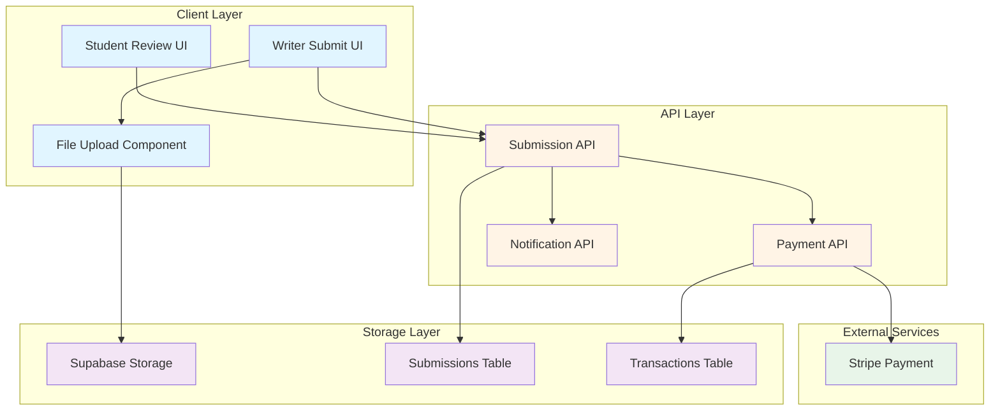
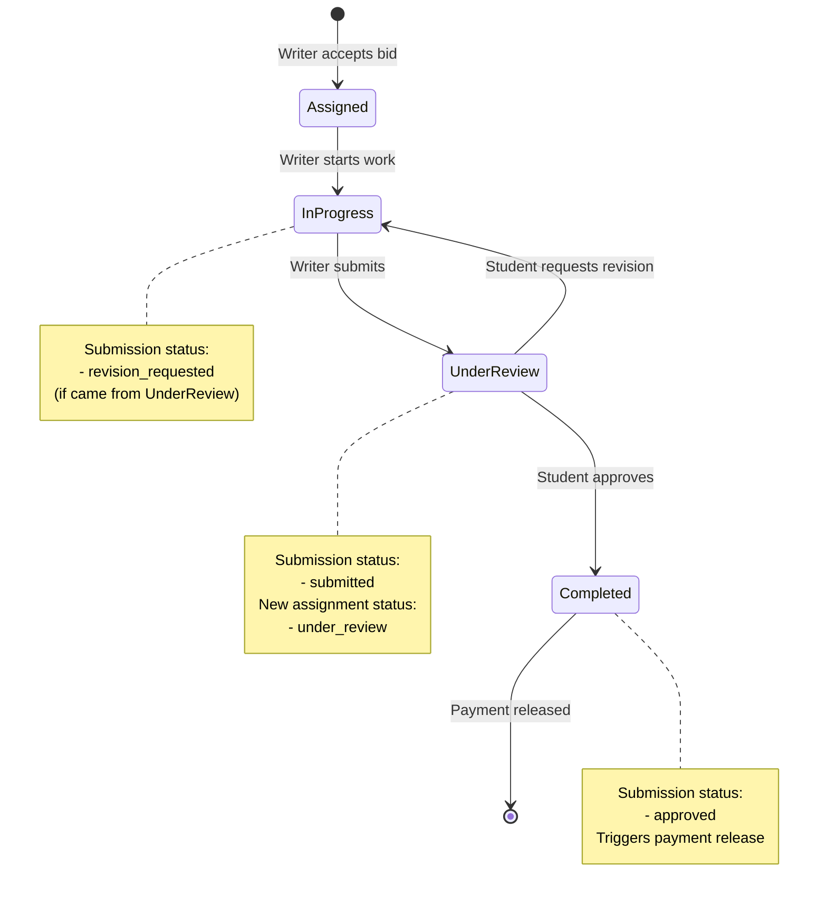

# Design Document: Assignment Submission & Review Workflow

## Overview

This document provides a comprehensive technical design for the assignment submission and review workflow feature. The feature enables writers to submit completed work with files, students to review submissions and provide feedback, and implements an automated revision workflow with payment release upon approval.

### Feature Summary

The submission workflow bridges the gap between assignment acceptance and completion by providing:

- **File Upload System**: Multi-file upload with drag-and-drop support using Supabase Storage
- **Submission Management**: Complete submission lifecycle from initial submit through revisions to approval
- **Review Interface**: Student-facing UI for reviewing work, approving, or requesting revisions
- **Revision Tracking**: Version control for submissions with parent-child relationships
- **Payment Integration**: Automatic payment release to writers upon approval via Stripe
- **Real-time Notifications**: In-app notifications for status changes and important events

### Context and Motivation

Currently, the platform supports assignment posting, bidding, and messaging, but lacks the critical submission and review functionality. Without this feature:
- Writers have no formal way to deliver completed work
- Students cannot review or provide structured feedback
- Payments remain in escrow indefinitely
- No audit trail of submission history exists

This feature completes the core transaction flow, enabling the platform to function as a full marketplace.

---

## Architecture

### System Architecture Overview



### State Machine: Submission Workflow



### Component Architecture

The feature is organized into the following layers:

1. **Presentation Layer** (React Components)
   - `SubmissionForm`: Writer's file upload and submission interface
   - `SubmissionReview`: Student's review and approval interface
   - `SubmissionHistory`: Timeline of all submissions and revisions
   - `FileUploader`: Reusable drag-and-drop file upload component

2. **Business Logic Layer** (API Routes/Server Actions)
   - `submitWork`: Handle writer file uploads and create submission record
   - `reviewSubmission`: Process student approval/revision requests
   - `releasePayment`: Trigger Stripe transfer to writer
   - `notifyParties`: Send notifications to relevant users

3. **Data Layer** (Database Operations)
   - Submission CRUD operations with RLS enforcement
   - File metadata management in Supabase Storage
   - Transaction record creation
   - Status updates with optimistic locking

4. **Integration Layer**
   - Supabase Storage client for file operations
   - Stripe API for payment processing
   - Real-time subscription for status updates

---

## Components and Interfaces

### Frontend Components

#### 1. SubmissionForm Component

**Location**: `components/submissions/SubmissionForm.jsx`

**Purpose**: Allow writers to submit completed work with files and notes

**Props**:
```typescript
interface SubmissionFormProps {
  assignmentId: string;
  writerId: string;
  onSuccess: () => void;
  onCancel: () => void;
}
```

**State Management**:
```typescript
interface SubmissionFormState {
  files: File[];
  submissionText: string;
  uploading: boolean;
  uploadProgress: { [filename: string]: number };
  errors: string[];
}
```

**Key Features**:
- Drag-and-drop file upload zone
- Multiple file selection
- File type validation (PDF, DOC, DOCX, TXT, ZIP)
- File size validation (max 50MB per file, 10 files total)
- Upload progress tracking per file
- Submission notes textarea
- Form validation before submission
- Cancel confirmation for unsaved work

**UI Flow**:
1. Display assignment summary (read-only)
2. Render drag-and-drop zone with "Browse Files" button
3. Show selected files list with remove option
4. Display upload progress bars during submission
5. Show submission notes textarea
6. Enable submit button only when files are selected
7. Display success message and redirect on completion

---

#### 2. SubmissionReview Component

**Location**: `components/submissions/SubmissionReview.jsx`

**Purpose**: Enable students to review submissions and approve or request revisions

**Props**:
```typescript
interface SubmissionReviewProps {
  assignmentId: string;
  submissionId: string;
  studentId: string;
  onActionComplete: () => void;
}
```

**State Management**:
```typescript
interface SubmissionReviewState {
  submission: Submission;
  feedback: string;
  action: 'approve' | 'revision' | null;
  confirmModalOpen: boolean;
  loading: boolean;
}
```

**Key Features**:
- Display submission metadata (date, revision number, writer notes)
- File list with download links and icons
- Expandable revision history accordion
- "Approve" button with confirmation modal
- "Request Revision" button opening feedback form
- Required feedback field for revision requests
- Optional feedback for approvals (thank you note)
- Link to messaging system

**UI States**:
- Loading: Fetching submission data
- Review: Normal review state with action buttons
- Approving: Confirmation modal displayed
- Revision Request: Feedback form displayed
- Processing: Action in progress
- Success: Action completed with notification

---

#### 3. FileUploader Component

**Location**: `components/shared/FileUploader.jsx`

**Purpose**: Reusable drag-and-drop file upload component

**Props**:
```typescript
interface FileUploaderProps {
  onFilesSelected: (files: File[]) => void;
  acceptedTypes: string[];
  maxFileSize: number;
  maxFiles: number;
  multiple: boolean;
}
```

**Features**:
- Drag-and-drop zone with hover state
- Click to browse fallback
- File type filtering
- File size validation
- Visual feedback for drag events
- Error display for invalid files
- Accessible keyboard navigation

---

#### 4. SubmissionHistory Component

**Location**: `components/submissions/SubmissionHistory.jsx`

**Purpose**: Display timeline of all submissions and revisions

**Props**:
```typescript
interface SubmissionHistoryProps {
  assignmentId: string;
  currentUser: Profile;
}
```

**Display**:
- Chronological list (newest first)
- Each submission shows:
  - Revision number badge
  - Submission date and time
  - Status badge (submitted, approved, revision_requested)
  - Writer notes preview
  - Student feedback (if applicable)
  - File count
  - Expandable file list
  - "Current" indicator for active submission

---

### Backend API Endpoints

#### 1. POST /api/submissions/submit

**Purpose**: Create a new submission and upload files

**Request Body**:
```typescript
interface SubmitWorkRequest {
  assignmentId: string;
  writerId: string;
  submissionText: string;
  files: FormData; // multipart/form-data
}
```

**Response**:
```typescript
interface SubmitWorkResponse {
  success: boolean;
  submissionId: string;
  fileUrls: string[];
  message: string;
}
```

**Process Flow**:
1. Validate request (assignment exists, writer is assigned, status is valid)
2. Create submission record with status 'submitted'
3. Upload files to Supabase Storage (`submissions/{assignmentId}/{submissionId}/`)
4. Store file URLs in submission record
5. Update assignment status to 'under_review'
6. Create notification for student
7. Return submission ID and file URLs

**Error Handling**:
- Invalid assignment: 404 Not Found
- Unauthorized writer: 403 Forbidden
- Invalid file type/size: 400 Bad Request
- Storage upload failure: 500 Internal Server Error with partial rollback
- Database error: 500 Internal Server Error with full rollback

---

#### 2. POST /api/submissions/review

**Purpose**: Approve submission or request revision

**Request Body**:
```typescript
interface ReviewSubmissionRequest {
  submissionId: string;
  studentId: string;
  action: 'approve' | 'revision';
  feedback?: string; // Required for 'revision', optional for 'approve'
  revisionNotes?: string; // Only for 'revision'
}
```

**Response**:
```typescript
interface ReviewSubmissionResponse {
  success: boolean;
  action: 'approve' | 'revision';
  newStatus: string;
  paymentReleased?: boolean;
  transactionId?: string;
  message: string;
}
```

**Process Flow (Approve)**:
1. Validate request (submission exists, student owns assignment)
2. Update submission status to 'approved'
3. Update assignment status to 'completed'
4. Trigger payment release (call Stripe API)
5. Create transaction record
6. Create notifications for both parties
7. Return success response

**Process Flow (Revision)**:
1. Validate request (submission exists, student owns assignment)
2. Validate feedback is provided and non-empty
3. Update submission status to 'revision_requested'
4. Store student feedback and revision notes
5. Update assignment status to 'in_progress'
6. Create notification for writer
7. Return success response

**Error Handling**:
- Invalid submission: 404 Not Found
- Unauthorized student: 403 Forbidden
- Missing feedback for revision: 400 Bad Request
- Payment release failure: 500 Internal Server Error (mark for manual review)
- Concurrent status change: 409 Conflict (use optimistic locking)

---

#### 3. POST /api/payments/release

**Purpose**: Release escrowed payment to writer

**Request Body**:
```typescript
interface ReleasePaymentRequest {
  assignmentId: string;
  submissionId: string;
  amount: number;
}
```

**Response**:
```typescript
interface ReleasePaymentResponse {
  success: boolean;
  transactionId: string;
  stripeTransferId: string;
  amountReleased: number;
  platformFee: number;
  writerEarnings: number;
}
```

**Process Flow**:
1. Fetch assignment and verify completion status
2. Calculate platform fee (15% default)
3. Calculate writer earnings (amount - platform fee)
4. Create Stripe Transfer to writer's connected account
5. Create transaction record with status 'released'
6. Update assignment payment_released flag
7. Return transaction details

**Error Handling**:
- Stripe API error: Retry with exponential backoff
- Insufficient funds: Mark transaction as 'failed', alert admin
- Writer account not connected: Queue for manual processing
- Database error: Rollback Stripe transfer if possible

---

### Database Schema Updates

The `submissions` table already exists (created via `supabase-submissions-complete.sql`). Here's the schema for reference:

```sql
CREATE TABLE public.submissions (
    id UUID DEFAULT uuid_generate_v4() PRIMARY KEY,
    assignment_id UUID REFERENCES public.assignments(id) ON DELETE CASCADE NOT NULL,
    writer_id UUID REFERENCES public.profiles(id) ON DELETE CASCADE NOT NULL,
    
    -- Submission details
    submission_text TEXT,
    file_urls TEXT[] NOT NULL DEFAULT '{}',
    
    -- Status
    status TEXT NOT NULL DEFAULT 'submitted' 
        CHECK (status IN ('submitted', 'approved', 'revision_requested', 'rejected')),
    
    -- Feedback
    student_feedback TEXT,
    revision_notes TEXT,
    
    -- Timestamps
    created_at TIMESTAMP WITH TIME ZONE DEFAULT NOW(),
    updated_at TIMESTAMP WITH TIME ZONE DEFAULT NOW(),
    
    -- Track revisions
    revision_number INTEGER DEFAULT 1,
    parent_submission_id UUID REFERENCES public.submissions(id) ON DELETE SET NULL
);
```

**Indexes** (already created):
- `idx_submissions_assignment` on `assignment_id`
- `idx_submissions_writer` on `writer_id`
- `idx_submissions_status` on `status`
- `idx_submissions_created` on `created_at DESC`

---

## Data Models

### Submission Model

```typescript
interface Submission {
  id: string;
  assignmentId: string;
  writerId: string;
  submissionText: string | null;
  fileUrls: string[];
  status: 'submitted' | 'approved' | 'revision_requested' | 'rejected';
  studentFeedback: string | null;
  revisionNotes: string | null;
  createdAt: string;
  updatedAt: string;
  revisionNumber: number;
  parentSubmissionId: string | null;
  
  // Populated relations
  writer?: Profile;
  assignment?: Assignment;
  revisions?: Submission[]; // Child revisions
}
```

### Assignment Status Updates

Existing `assignments` table statuses are extended to include submission workflow:

```typescript
type AssignmentStatus = 
  | 'open'         // New assignment, accepting bids
  | 'assigned'     // Writer's bid accepted
  | 'in_progress'  // Writer working on assignment
  | 'under_review' // Submission waiting for student review
  | 'completed'    // Work approved, payment released
  | 'cancelled'    // Assignment cancelled
  | 'disputed';    // Dispute raised (future)
```

### Transaction Model

```typescript
interface Transaction {
  id: string;
  assignmentId: string;
  studentId: string;
  writerId: string;
  amount: number;
  platformFee: number;
  writerEarnings: number;
  stripePaymentIntentId: string | null;
  stripeTransferId: string | null;
  status: 'pending' | 'held' | 'released' | 'refunded' | 'failed';
  transactionType: 'payment' | 'refund' | 'withdrawal';
  metadata: Record<string, any>;
  createdAt: string;
  updatedAt: string;
}
```

### File Storage Structure

Files are organized in Supabase Storage as follows:

```
submissions/
  {assignmentId}/
    {submissionId}/
      document1.pdf
      essay.docx
      sources.zip
      ...
```

**URL Format**: `https://{project}.supabase.co/storage/v1/object/public/submissions/{assignmentId}/{submissionId}/{filename}`

---

## Error Handling

### Client-Side Validation

**File Upload Validation**:
- File type checking before upload (PDF, DOC, DOCX, TXT, ZIP)
- File size validation (max 50MB per file)
- Total file count limit (max 10 files per submission)
- Immediate user feedback for invalid files

**Form Validation**:
- At least one file required for submission
- Submission notes optional but recommended
- Feedback required for revision requests (min 10 characters)

### Server-Side Error Handling

**Upload Errors**:
```typescript
try {
  const uploadPromises = files.map(file => uploadToSupabase(file));
  const results = await Promise.allSettled(uploadPromises);
  
  const successful = results.filter(r => r.status === 'fulfilled');
  const failed = results.filter(r => r.status === 'rejected');
  
  if (failed.length > 0) {
    // Log failures
    console.error('Upload failures:', failed);
    
    // Rollback successful uploads if any failed
    await Promise.all(successful.map(r => deleteFromSupabase(r.value)));
    
    throw new Error(`Failed to upload ${failed.length} file(s)`);
  }
  
  return successful.map(r => r.value.url);
} catch (error) {
  throw new APIError('File upload failed', 500);
}
```

**Payment Release Errors**:
```typescript
try {
  const transfer = await stripe.transfers.create({
    amount: writerEarnings,
    currency: 'usd',
    destination: writerStripeAccountId,
    transfer_group: assignmentId,
  });
  
  return { success: true, transferId: transfer.id };
} catch (error) {
  if (error.type === 'StripeCardError') {
    // Retry with exponential backoff
    await retryWithBackoff(() => stripe.transfers.create(params));
  } else {
    // Log for manual review
    await logPaymentFailure({
      assignmentId,
      error: error.message,
      requiresManualIntervention: true,
    });
    
    throw new APIError('Payment release failed', 500);
  }
}
```

### Edge Case Handling

**Concurrent Submission Reviews**:
Use optimistic locking with `updated_at` timestamp:

```typescript
const { data, error } = await supabase
  .from('submissions')
  .update({ status: 'approved', updated_at: new Date() })
  .eq('id', submissionId)
  .eq('updated_at', currentUpdatedAt) // Ensure no concurrent changes
  .select();

if (data.length === 0) {
  throw new APIError('Submission was modified by another user', 409);
}
```

**Multiple Submissions Before Review**:
```typescript
// Check if there's already a submission under review
const { data: existingSubmissions } = await supabase
  .from('submissions')
  .select('id')
  .eq('assignment_id', assignmentId)
  .eq('status', 'submitted');

if (existingSubmissions && existingSubmissions.length > 0) {
  throw new APIError('Cannot submit while previous submission is under review', 400);
}
```

**Assignment Cancelled After Submission**:
```typescript
// Check assignment status before allowing actions
if (assignment.status === 'cancelled') {
  // Calculate partial payment (50% for post-submission cancellation)
  const partialAmount = assignment.final_price * 0.5;
  await releasePayment(assignmentId, partialAmount);
  
  return {
    success: true,
    message: 'Assignment cancelled. Partial payment released.',
    amountReleased: partialAmount,
  };
}
```

---

## Testing Strategy

### Assessment of Property-Based Testing Applicability

This feature is **NOT suitable for property-based testing** due to the following characteristics:

1. **Heavy External Dependencies**: The feature relies heavily on Supabase Storage (file uploads), Stripe API (payments), and database I/O, which are expensive to run 100+ times.

2. **UI-Centric Behavior**: Much of the functionality involves UI interactions (drag-and-drop, form validation, button clicks) that are better tested with example-based integration tests.

3. **Side-Effect Heavy**: The core operations (file upload, payment processing, status updates) are side-effect operations without pure return values that benefit from property-based testing.

4. **Configuration and Integration**: The feature primarily tests that components are "wired up correctly" (file storage policies, payment integration, notification triggers), which is better validated through integration tests.

5. **Business Logic is Simple**: The status transitions and validation logic are straightforward conditionals that don't have complex input spaces requiring property-based exploration.

**Testing Approach**: This feature will use **example-based unit tests** for validation logic and **integration tests** for end-to-end workflows, supplemented by **manual testing** for UI/UX flows.

---

### Unit Testing

**Test Coverage**:

1. **File Validation Functions**
   - `validateFileType(file)`: Test accepted and rejected file types
   - `validateFileSize(file, maxSize)`: Test under, at, and over limit
   - `validateFileCount(files, maxCount)`: Test within and exceeding limit

2. **Status Transition Logic**
   - `canSubmit(assignment)`: Test valid and invalid statuses
   - `canReview(submission, user)`: Test ownership and status checks
   - `getNextStatus(action, currentStatus)`: Test state transitions

3. **Payment Calculation**
   - `calculatePlatformFee(amount, rate)`: Test various amounts and rates
   - `calculateWriterEarnings(amount, fee)`: Test earnings calculation
   - `formatCurrency(amount)`: Test currency formatting

**Example Test**:
```typescript
describe('validateFileType', () => {
  it('accepts PDF files', () => {
    const file = new File(['content'], 'document.pdf', { type: 'application/pdf' });
    expect(validateFileType(file)).toBe(true);
  });

  it('rejects image files', () => {
    const file = new File(['content'], 'image.jpg', { type: 'image/jpeg' });
    expect(validateFileType(file)).toBe(false);
  });

  it('accepts DOCX files', () => {
    const file = new File(['content'], 'essay.docx', {
      type: 'application/vnd.openxmlformats-officedocument.wordprocessingml.document'
    });
    expect(validateFileType(file)).toBe(true);
  });
});
```

---

### Integration Testing

**Test Scenarios**:

1. **Complete Submission Flow**
   - Writer uploads files → Submission created → Assignment status updated → Student notified
   - Verify files are stored in correct path
   - Verify database records are created correctly
   - Verify notifications are sent

2. **Approval Flow**
   - Student approves submission → Submission status updated → Payment released → Both parties notified
   - Mock Stripe API calls
   - Verify transaction record creation
   - Verify assignment status changes to 'completed'

3. **Revision Request Flow**
   - Student requests revision → Submission status updated → Writer notified → Writer resubmits
   - Verify revision number increments
   - Verify parent_submission_id is set correctly
   - Verify feedback is stored

4. **Error Recovery**
   - Partial file upload failure → Rollback all files → Show error to user
   - Payment release failure → Transaction marked as 'failed' → Admin notified
   - Concurrent status update → Second request rejected with 409 Conflict

**Example Integration Test**:
```typescript
describe('Submission Workflow', () => {
  it('completes full submission and approval flow', async () => {
    // Setup
    const { student, writer, assignment } = await setupTestData();
    
    // Writer submits work
    const files = [
      createMockFile('essay.pdf', 'application/pdf'),
      createMockFile('sources.docx', 'application/docx'),
    ];
    
    const submission = await submitWork({
      assignmentId: assignment.id,
      writerId: writer.id,
      files,
      submissionText: 'Completed work as discussed',
    });
    
    expect(submission.status).toBe('submitted');
    expect(submission.fileUrls).toHaveLength(2);
    
    // Verify assignment status changed
    const updatedAssignment = await getAssignment(assignment.id);
    expect(updatedAssignment.status).toBe('under_review');
    
    // Student approves
    const result = await reviewSubmission({
      submissionId: submission.id,
      studentId: student.id,
      action: 'approve',
      feedback: 'Great work!',
    });
    
    expect(result.success).toBe(true);
    expect(result.paymentReleased).toBe(true);
    
    // Verify final states
    const finalSubmission = await getSubmission(submission.id);
    expect(finalSubmission.status).toBe('approved');
    
    const finalAssignment = await getAssignment(assignment.id);
    expect(finalAssignment.status).toBe('completed');
    
    const transaction = await getTransaction(result.transactionId);
    expect(transaction.status).toBe('released');
  });
});
```

---

### UI/UX Testing

**Manual Test Cases**:

1. **File Upload UX**
   - Drag files onto upload zone → Visual feedback during drag
   - Drop files → Files appear in list with correct icons
   - Click remove button → File removed from list
   - Upload large file → Progress bar shows accurately
   - Upload invalid file → Error message displayed inline

2. **Submission Form**
   - Fill form with files and notes → Submit button enabled
   - Click submit → Loading state shown, then success message
   - Try to navigate away with unsaved changes → Confirmation prompt
   - Upload fails → Error message with retry option

3. **Review Interface**
   - View submission → All files listed with download links
   - Click approve → Confirmation modal shown
   - Confirm approval → Success message and redirect
   - Click request revision → Feedback form shown
   - Submit without feedback → Validation error
   - Submit with feedback → Success message and status updated

4. **Responsive Design**
   - Test on mobile (375px) → Layout adapts, touch targets adequate
   - Test on tablet (768px) → Two-column layout where appropriate
   - Test on desktop (1440px) → Full layout with sidebar

**Accessibility Testing**:
- Keyboard navigation → All actions accessible via keyboard
- Screen reader → Form labels and ARIA attributes present
- Color contrast → WCAG AA compliance (4.5:1 for text)
- Focus indicators → Visible focus styles on interactive elements

---

### Monitoring and Logging

**Key Metrics to Track**:
- Submission success rate
- Average file upload time
- Payment release success rate
- Revision request rate
- Time to review (student → approval/revision)

**Logging Requirements**:
```typescript
// Successful submission
logger.info('Submission created', {
  submissionId,
  assignmentId,
  writerId,
  fileCount: files.length,
  totalSize: calculateTotalSize(files),
});

// Payment release
logger.info('Payment released', {
  transactionId,
  assignmentId,
  amount,
  platformFee,
  writerEarnings,
  stripeTransferId,
});

// Payment failure
logger.error('Payment release failed', {
  assignmentId,
  error: error.message,
  requiresManualIntervention: true,
  writerEmail: writer.email,
});
```

---

## Security Considerations

### Row Level Security (RLS)

**Submissions Table Policies** (already implemented):

1. **View Policy**: Writers and assignment owners can view submissions
```sql
CREATE POLICY "Writers can view own submissions" ON public.submissions
    FOR SELECT USING (
        auth.uid() = writer_id OR
        auth.uid() IN (
            SELECT student_id FROM public.assignments WHERE id = assignment_id
        )
    );
```

2. **Create Policy**: Writers can create submissions for their assigned assignments
```sql
CREATE POLICY "Writers can create submissions" ON public.submissions
    FOR INSERT WITH CHECK (
        auth.uid() = writer_id AND
        EXISTS (
            SELECT 1 FROM public.assignments 
            WHERE id = assignment_id 
            AND assigned_writer_id = auth.uid()
            AND status IN ('assigned', 'in_progress')
        )
    );
```

3. **Update Policy (Students)**: Students can update submissions to approve or request revisions
```sql
CREATE POLICY "Students can update submissions" ON public.submissions
    FOR UPDATE USING (
        auth.uid() IN (
            SELECT student_id FROM public.assignments WHERE id = assignment_id
        )
    );
```

4. **Update Policy (Writers)**: Writers can update their own submissions (for revisions)
```sql
CREATE POLICY "Writers can update own submissions" ON public.submissions
    FOR UPDATE USING (
        auth.uid() = writer_id
    );
```

### Storage Security

**Submissions Bucket Policies** (to be implemented):

1. **Upload Policy**: Writers can only upload to their assigned assignments
```sql
CREATE POLICY "Writers can upload to their assignments"
ON storage.objects FOR INSERT
TO authenticated
WITH CHECK (
  bucket_id = 'submissions' 
  AND (storage.foldername(name))[1] IN (
    SELECT id::text FROM public.assignments 
    WHERE assigned_writer_id = auth.uid()
  )
);
```

2. **View Policy**: Assignment parties (student and writer) can view files
```sql
CREATE POLICY "Assignment parties can view submissions"
ON storage.objects FOR SELECT
TO authenticated
USING (
  bucket_id = 'submissions' 
  AND (storage.foldername(name))[1] IN (
    SELECT id::text FROM public.assignments 
    WHERE student_id = auth.uid() OR assigned_writer_id = auth.uid()
  )
);
```

3. **Delete Policy**: Writers can delete their submission files
```sql
CREATE POLICY "Writers can delete their submission files"
ON storage.objects FOR DELETE
TO authenticated
USING (
  bucket_id = 'submissions' 
  AND (storage.foldername(name))[1] IN (
    SELECT id::text FROM public.assignments 
    WHERE assigned_writer_id = auth.uid()
  )
);
```

### Input Validation

**Server-Side Validation** (critical):
- File type validation using MIME type checking (not just extension)
- File size validation before storage write
- Assignment ownership verification before all operations
- Status validation before state transitions
- SQL injection prevention (using parameterized queries)

**Rate Limiting**:
- Limit submissions per writer per assignment (prevent spam)
- Limit file uploads per minute per user
- Limit review actions per student per hour

### Data Privacy

**Personal Data Handling**:
- File content is not scanned or analyzed (privacy by design)
- Submission notes and feedback are visible only to assignment parties
- No third-party analytics on file content
- File URLs are authenticated (not publicly accessible)

**GDPR Compliance** (future consideration):
- Right to deletion: Files removed when user account deleted
- Data portability: Export submission history in machine-readable format
- Consent tracking: Log user actions with timestamps

---

## Performance Optimization

### File Upload Optimization

**Chunked Uploads**: For files larger than 5MB, implement chunked upload to prevent timeouts:

```typescript
async function uploadLargeFile(file: File, path: string) {
  const chunkSize = 5 * 1024 * 1024; // 5MB chunks
  const chunks = Math.ceil(file.size / chunkSize);
  
  for (let i = 0; i < chunks; i++) {
    const start = i * chunkSize;
    const end = Math.min(start + chunkSize, file.size);
    const chunk = file.slice(start, end);
    
    await uploadChunk(chunk, path, i, chunks);
    
    // Update progress
    const progress = ((i + 1) / chunks) * 100;
    onProgress(progress);
  }
}
```

**Parallel Uploads**: Upload multiple files concurrently (max 3 at a time):

```typescript
async function uploadFiles(files: File[]) {
  const batchSize = 3;
  const results = [];
  
  for (let i = 0; i < files.length; i += batchSize) {
    const batch = files.slice(i, i + batchSize);
    const batchResults = await Promise.all(
      batch.map(file => uploadFile(file))
    );
    results.push(...batchResults);
  }
  
  return results;
}
```

### Database Query Optimization

**Indexed Queries**: All queries use existing indexes:
- Submissions by assignment: Uses `idx_submissions_assignment`
- Submissions by writer: Uses `idx_submissions_writer`
- Submissions by status: Uses `idx_submissions_status`

**Query Batching**: Fetch related data in single query:

```typescript
const { data: submission } = await supabase
  .from('submissions')
  .select(`
    *,
    writer:profiles!writer_id(id, full_name, avatar_url),
    assignment:assignments!assignment_id(
      id, 
      title, 
      final_price,
      student:profiles!student_id(id, full_name)
    )
  `)
  .eq('id', submissionId)
  .single();
```

### Caching Strategy

**Client-Side Caching**:
- Cache submission list for 30 seconds (stale-while-revalidate)
- Cache assignment details for 5 minutes
- Invalidate cache on submission/review actions

**CDN Caching** (Supabase Storage):
- File URLs are cached by CDN (Supabase's CloudFlare integration)
- Cache-Control header: `public, max-age=3600` (1 hour)

---

## Real-Time Features

### Status Update Subscriptions

**Writer Dashboard**: Subscribe to assignment status changes

```typescript
useEffect(() => {
  const subscription = supabase
    .channel(`assignment:${assignmentId}`)
    .on(
      'postgres_changes',
      {
        event: 'UPDATE',
        schema: 'public',
        table: 'assignments',
        filter: `id=eq.${assignmentId}`,
      },
      (payload) => {
        // Update UI when status changes
        setAssignment(payload.new);
        
        // Show notification
        if (payload.new.status === 'under_review') {
          toast.success('Student is reviewing your submission');
        }
      }
    )
    .subscribe();

  return () => {
    subscription.unsubscribe();
  };
}, [assignmentId]);
```

**Student Dashboard**: Subscribe to new submissions

```typescript
useEffect(() => {
  const subscription = supabase
    .channel(`submissions:${studentId}`)
    .on(
      'postgres_changes',
      {
        event: 'INSERT',
        schema: 'public',
        table: 'submissions',
      },
      (payload) => {
        // Check if submission is for student's assignment
        if (studentAssignmentIds.includes(payload.new.assignment_id)) {
          // Show notification
          toast.info('New submission received!');
          
          // Refresh submissions list
          fetchSubmissions();
        }
      }
    )
    .subscribe();

  return () => {
    subscription.unsubscribe();
  };
}, [studentId, studentAssignmentIds]);
```

---

## Deployment Considerations

### Environment Variables

**Required Environment Variables**:
```bash
# Supabase
NEXT_PUBLIC_SUPABASE_URL=https://{project}.supabase.co
NEXT_PUBLIC_SUPABASE_ANON_KEY={anon_key}

# Stripe
NEXT_PUBLIC_STRIPE_PUBLISHABLE_KEY=pk_live_...
STRIPE_SECRET_KEY=sk_live_...
STRIPE_WEBHOOK_SECRET=whsec_...

# Application
PLATFORM_FEE_PERCENTAGE=15
MAX_FILE_SIZE_MB=50
MAX_FILES_PER_SUBMISSION=10
```

### Database Migrations

**Migration Steps**:
1. ✅ Run `supabase-submissions-complete.sql` (already done)
2. Create `submissions` storage bucket (manual step)
3. Apply storage policies (included in SQL file)
4. Verify RLS policies are active

**Rollback Plan**:
- Drop submissions table: `DROP TABLE IF EXISTS public.submissions CASCADE;`
- Delete storage bucket (manual step in Supabase dashboard)
- Revert assignment status enum (if modified)

### Monitoring Setup

**Key Alerts**:
- Payment release failure rate > 1%
- File upload failure rate > 5%
- Average submission creation time > 10 seconds
- Storage usage approaching limit (> 80%)

**Dashboards**:
- Submission metrics: Daily submission count, approval rate, revision rate
- Payment metrics: Daily transactions, total released, failed releases
- Performance metrics: Upload duration P50/P95, API response times

---

## Future Enhancements

### Phase 2 Features

1. **File Preview**: Inline PDF and image preview (using React PDF Viewer)
2. **Version Diff**: Side-by-side comparison of submission revisions
3. **Bulk Download**: Download all submission files as ZIP
4. **Auto-Approval**: Configurable auto-approval after X days of inactivity
5. **Email Notifications**: Supplement in-app notifications with email

### Phase 3 Features

1. **Plagiarism Detection**: Integration with Turnitin or Copyscape API
2. **Grammar Checking**: Integration with Grammarly API for writer assistance
3. **Collaborative Editing**: Real-time document editing with student feedback
4. **Video Submissions**: Support for video file uploads and streaming
5. **Anonymous Review**: Option for blind peer review

### Technical Debt

1. **File Cleanup**: Implement automatic deletion of old submission files (> 90 days after completion)
2. **Virus Scanning**: Add ClamAV integration for uploaded file scanning
3. **Compression**: Implement automatic file compression for large uploads
4. **Audit Logging**: Comprehensive audit trail for all submission actions

---

## Dependencies

### NPM Packages

**Required**:
- `@supabase/supabase-js`: ^2.x (Supabase client)
- `@stripe/stripe-js`: ^2.x (Stripe client)
- `stripe`: ^14.x (Stripe server SDK)
- `react-dropzone`: ^14.x (Drag-and-drop file upload)
- `lucide-react`: ^0.x (Icons)
- `react-hot-toast`: ^2.x (Notifications)

**Optional**:
- `@react-pdf-viewer/core`: ^3.x (PDF preview)
- `file-saver`: ^2.x (File download helper)
- `jszip`: ^3.x (ZIP file generation for bulk download)

### External Services

**Supabase**:
- PostgreSQL database (submissions table, RLS policies)
- Storage (file hosting)
- Real-time subscriptions (status updates)

**Stripe**:
- Transfers API (payment release)
- Connected Accounts (writer payouts)
- Webhooks (payment confirmation)

---

## Success Metrics

### Key Performance Indicators (KPIs)

1. **Submission Success Rate**: Target > 95%
   - Metric: (Successful submissions / Total submission attempts) × 100

2. **Time to First Submission**: Target < 24 hours after assignment start
   - Metric: Average time from assignment 'assigned' to first submission

3. **Review Turnaround Time**: Target < 48 hours
   - Metric: Average time from submission to approval/revision request

4. **Revision Rate**: Target < 30%
   - Metric: (Revision requests / Total submissions) × 100

5. **Payment Release Success Rate**: Target > 99%
   - Metric: (Successful payment releases / Total payment attempts) × 100

### User Satisfaction

1. **Writer Satisfaction**: Post-approval survey (5-star rating)
   - Target: Average rating > 4.0

2. **Student Satisfaction**: Post-submission survey (5-star rating)
   - Target: Average rating > 4.0

3. **Feature Usage**: Submission feature adoption
   - Target: > 80% of completed assignments use submission workflow

---

## Glossary

- **Submission**: A writer's delivery of completed work for an assignment, including files and notes
- **Revision**: A new version of a submission created after student requests changes
- **Approval**: Student's acceptance of submitted work, triggering payment release
- **Escrow**: Temporary holding of payment until work is approved
- **RLS (Row Level Security)**: Database-level access control enforced by Supabase
- **Optimistic Locking**: Concurrency control using timestamp comparison
- **Chunked Upload**: Breaking large files into smaller pieces for more reliable transfer

---

## References

- [Supabase Storage Documentation](https://supabase.com/docs/guides/storage)
- [Stripe Transfers API](https://stripe.com/docs/api/transfers)
- [React Dropzone](https://react-dropzone.js.org/)
- [Next.js API Routes](https://nextjs.org/docs/api-routes/introduction)
- [PostgreSQL Row Level Security](https://www.postgresql.org/docs/current/ddl-rowsecurity.html)

---

**Document Status**: ✅ Design Complete - Ready for Implementation

**Last Updated**: 2024-01-24

**Author**: Kiro AI Agent

**Reviewers**: Pending stakeholder review
